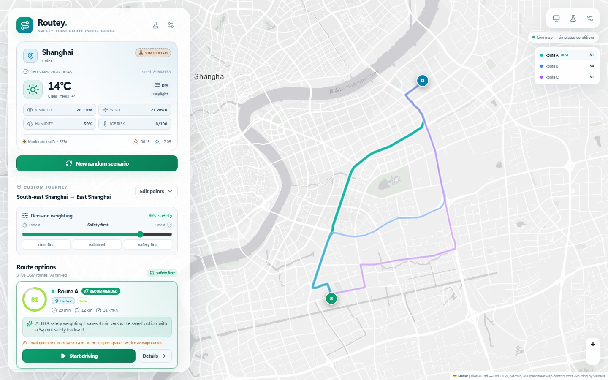
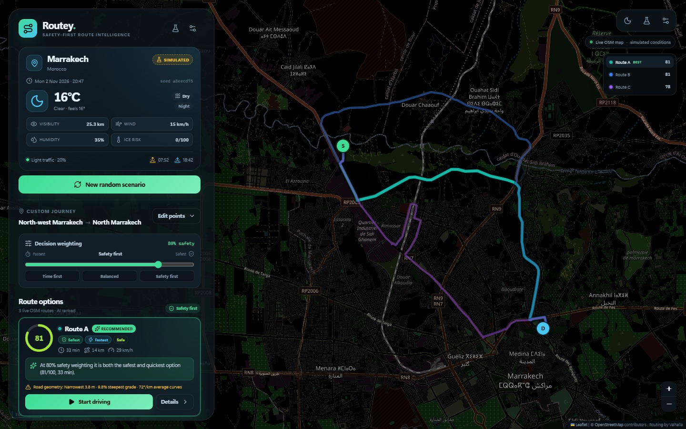
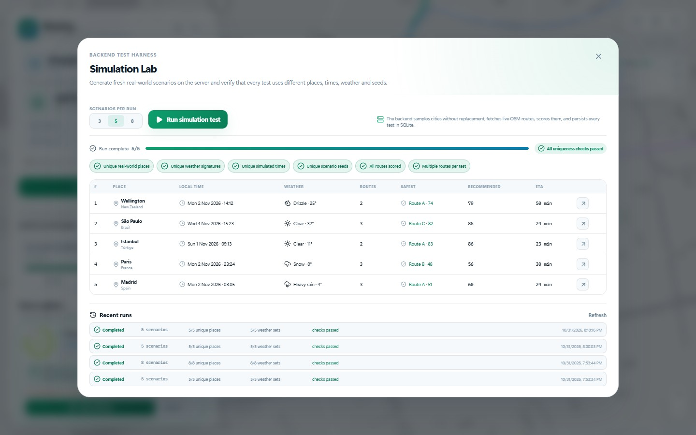

# Routey

**Safety-first route intelligence — a website, not a native app.**

Routey explores real-world routes on a live OpenStreetMap, generates a fresh simulated
set of weather, daylight, traffic, and road conditions, then recommends a route with an
explainable safety score and a reason under every alternative.

> **Simulation demo — not for real navigation.** Weather, traffic, road width, surface,
> grade, crash history and other road attributes are generated. Map tiles, road geometry,
> turn maneuvers and base travel times come from live OpenStreetMap services. Never use
> Routey for real driving or safety decisions.



## What it does

- **Live map, real roads.** A Leaflet map uses Esri Light/Dark Gray basemap tiles with a
  label overlay, and Valhalla routing. Every scenario uses real road geometry, real turn
  maneuvers and real distances.
- **Random world simulator.** The backend picks a real city from a curated global
  catalogue, samples two points within its road network, fetches live routes, and generates
  a seed-specific time, weather, daylight phase, traffic profile, and road-condition story.
- **Safety score.** A transparent local risk engine scores every segment from six factor
  groups, compounds dangerous combinations (ice + steep bend, fog + unlit road, etc.), and
  applies a worst-segment penalty.
- **Route recommendations.** Compare two or three live routes. Each card shows its safety
  score, safety label, ETA, distance, average speed, recommendation/trade-off reason, and
  its top simulated hazard.
- **Adjustable decision weighting.** Slide between *Fastest* and *Safest*. The backend
  re-ranks the routes and rewrites the recommendation reasons at the chosen weighting.
- **AI reasoning.** The local explainable engine decides every score and generates reasons
  under every path. An optional OpenAI-compatible LLM can rewrite/enrich explanations; it
  is explicitly instructed never to change scores or invent conditions.
- **Search, click, or randomize.** Search with Nominatim, click the map to drop a start or
  destination, or let the simulator choose everything.
- **Full driving simulation.** Start driving, watch the car move along the real road
  geometry, follow the next maneuver, scrub progress, change simulation speed, and get an
  arrival summary. Time advances and daylight phases change during the drive.
- **Simulation Lab.** A backend test harness runs 3–8 fresh scenarios, verifies that places,
  weather signatures, times and seeds are all unique, and stores every run in SQLite.
- **Auto / light / dark theme.** Auto follows the operating-system preference; manual
  overrides are stored locally. The dark map uses Esri's Dark Gray basemap and reference
  label overlay.



## Stack

| Layer | Technology |
| --- | --- |
| Frontend | React 19, Vite 8, TypeScript, Leaflet, lucide-react |
| Backend | Bun 1.3, Hono, Zod |
| Database | SQLite via `bun:sqlite` (WAL mode) |
| Map tiles | Esri Light/Dark Gray basemap + reference labels |
| Routing | Valhalla public OSM router (`valhalla1.openstreetmap.de`) |
| Geocoding | Nominatim (`nominatim.openstreetmap.org`) |
| Optional AI narrative | Any OpenAI-compatible chat-completions endpoint, e.g. OpenRouter |

### Why Valhalla instead of the OSRM demo server?

The public `router.project-osrm.org` demo server has incomplete global coverage — during
testing it failed for Tokyo, Sydney, Vancouver and Mexico City. Valhalla successfully routed
all continents in testing and returns route alternatives, encoded geometry and maneuver
instructions. Routing is still live OSM data; OSRM is not required.

## Quick start

Requires **Bun 1.3+** and an internet connection for map tiles, routing and geocoding.

```bash
bun install
bun run dev
```

Open <http://localhost:5173>. Vite proxies `/api` to the Bun server on port 8787.

Production-style local run:

```bash
bun run build
bun run start
```

Open <http://localhost:8787>. The Bun server serves the built frontend and the API from
one process.

The SQLite database is created automatically at `data/routey.db` and is gitignored.

### Configuration

Copy `.env.example` to `.env` if you want to override defaults:

```env
PORT=8787
ROUTEY_DB=data/routey.db
VALHALLA_URL=https://valhalla1.openstreetmap.de/route
NOMINATIM_USER_AGENT=Routey/1.0 (local simulation demo)
NOMINATIM_EMAIL=

# Optional: richer LLM-written explanations. Scores are still decided locally.
LLM_API_KEY=
LLM_BASE_URL=https://openrouter.ai/api/v1
LLM_MODEL=deepseek/deepseek-chat
```

Bun loads `.env` automatically. The LLM key stays on the server and is never sent to the
browser. Without a key, Routey uses its local explainable model and templates.

## How the simulation works

1. **Pick a place.** A curated catalogue of 80+ real cities provides a centre point,
   bounding box, IANA timezone and climate class. Random scenarios avoid the last five
   cities used; the Lab samples cities without replacement.
2. **Pick two points.** Two coordinates are sampled in the city box, constrained to a
   plausible 2.2–12.5 km separation. The simulator retries if the live router cannot find a
   drivable path.
3. **Generate the story.** From the scenario seed:
   - local date/time, solar elevation, sunrise/sunset and daylight phase;
   - climate- and season-aware temperature, precipitation, fog, visibility, wind, humidity
     and ice risk;
   - traffic volume from local rush hour, weather pressure and seeded variation;
   - per-road-segment width, lanes, speed limit, grade, surface, quality, lighting,
     shoulders, junction density, crash-history index, school zones, flood and animal risk.
4. **Fetch real routes.** Valhalla returns up to two alternatives. If fewer than two exist,
   Routey requests a real detour through a seeded waypoint, so comparisons remain real
   roads rather than fabricated geometry.
5. **Score and explain.** The local risk engine computes segment risks, factors, route
   safety, efficiency, overall recommendation and per-route reasons.
6. **Persist.** The scenario, simulated data, route geometry, maneuvers, segments, factors,
   reasons, and map-provider cache entries are stored in SQLite.

The **Simulation Lab** runs this pipeline server-side and then verifies:

- unique real-world places,
- unique weather signatures,
- unique simulated times,
- unique scenario seeds,
- every route scored,
- more than one route per scenario where available.



## Safety model

Each segment gets six risk values (0–100). They are combined with these weights:

| Factor | Weight | Examples |
| --- | ---: | --- |
| Weather | 27% | rain/snow intensity, ice, wind, temperature extremes |
| Visibility & daylight | 16% | visibility, fog, solar phase, street lighting |
| Road geometry | 21% | width, lanes, grade, curvature, shoulders |
| Surface | 10% | asphalt/gravel/unpaved, surface quality, wet/icy state |
| Traffic | 13% | congestion, junction density, speed environment |
| Road context | 13% | crash-history index, school zones, flood/animal risk |

Compounding hazards add extra risk, for example:

- ice on a steep or curved segment,
- heavy precipitation on a narrow road,
- low visibility on an unlit segment,
- high wind on a high-speed road,
- snow on a steep grade.

The route risk is the distance-weighted average plus a **12% worst-segment penalty**, so a
single very bad segment cannot be hidden by otherwise easy roads. Safety is
`100 − route risk`, clamped to 1–99.

Efficiency compares simulated ETA, distance and traffic exposure with the fastest option.
The overall recommendation is:

```text
overall = safetyWeight × safety + (1 − safetyWeight) × efficiency
```

The default is **80% safety / 20% efficiency**. The sidebar slider changes the weighting;
the backend re-ranks the routes and updates every recommendation reason.

## Database

SQLite tables created automatically:

| Table | Purpose |
| --- | --- |
| `cities` | Seeded global city catalogue with bbox, timezone and climate |
| `scenarios` | Seed, place, simulated time, weather, traffic, priority |
| `routes` | Geometry, maneuvers, road segments, scores, factors, reasons |
| `map_cache` | Cached Valhalla and Nominatim responses with TTL |
| `lab_runs` | Backend test runs, checks, progress and summaries |
| `lab_run_scenarios` | Links Lab runs to generated scenarios |

Route geometry and maneuvers are real map data; generated conditions and scores are stored
alongside them for auditability. Map raster tiles are not stored in SQLite.

## API

| Method | Path | Purpose |
| --- | --- | --- |
| `GET` | `/api/health` | Health, scenario/cache counts, LLM status |
| `GET` | `/api/config` | Public configuration, no secrets |
| `GET` | `/api/cities` | Curated real-world city catalogue |
| `POST` | `/api/scenarios/random` | Generate a seeded random scenario |
| `POST` | `/api/scenarios/custom` | Route between two searched/clicked points |
| `GET` | `/api/scenarios/latest` | Latest stored scenario |
| `GET` | `/api/scenarios/:id` | Fetch a stored scenario |
| `POST` | `/api/scenarios/:id/rank` | Re-rank with a new safety weighting |
| `GET` | `/api/geocode/search?q=` | Cached Nominatim search |
| `GET` | `/api/geocode/reverse?lat=&lon=` | Cached reverse geocoding |
| `POST` | `/api/ai/explain` | Local or optional LLM explanation |
| `POST` | `/api/lab/runs` | Start a backend Simulation Lab run |
| `GET` | `/api/lab/runs/:id` | Poll Lab progress and checks |
| `GET` | `/api/lab/runs` | Recent Lab history |

Example:

```bash
curl -X POST http://localhost:8787/api/scenarios/random \
  -H "Content-Type: application/json" \
  -d '{"priority":0.8}'
```

## Testing

```bash
bun test              # 16 deterministic unit tests
bun run test:live     # live smoke: 4 real scenarios with uniqueness assertions
bun run test:e2e      # self-contained browser E2E (Edge + Playwright via uv)
```

The E2E starts a temporary server on port 8799 with a throw-away SQLite database, builds the
current frontend, tests randomizing, re-ranking, details, driving/arrival, and the
Simulation Lab, then shuts everything down. Screenshots are written to
`devtests/screenshots/` (gitignored).

The repository contains additional manual visual scripts under `devtests/` used during the
build.

## Deployment

The backend must run somewhere. **Cloudflare Workers/Pages alone cannot run `Bun.serve` or
`bun:sqlite`**, so a Cloudflare deployment is split into two parts:

1. **Cloudflare Worker** — serves the built Vite frontend from `dist` and proxies `/api/*`
   to the backend.
2. **Bun backend** — runs the existing Hono/SQLite server on a host with a persistent disk
   (Render, Railway, Fly.io, Docker, etc.).

### Cloudflare Workers (frontend + API proxy)

The repository includes `wrangler.jsonc` and `server/worker.ts` specifically for this.

Cloudflare settings:

| Setting | Value |
| --- | --- |
| Worker name | `hackathonprojectaft` |
| Build command | `bun run build` |
| Deploy command | `npx wrangler deploy` |
| Root directory | repository root |
| Build output directory | `dist` (also configured in `wrangler.jsonc`) |

The Worker:

- serves `dist/` through the `ASSETS` binding,
- sends `/api` and `/api/*` to `API_ORIGIN`,
- returns a clear JSON 503 if `API_ORIGIN` is missing.

Set the backend URL as a Cloudflare **Variable** (not a secret, unless you prefer):

```text
API_ORIGIN=https://your-routey-backend.example.com
```

Do not include a trailing slash. Example: `https://routey-api.onrender.com`.

> A Worker-only deployment without `API_ORIGIN` will show the Routey interface but all
> data/route requests will fail with `backend_not_configured`. This is expected.

### Backend on Render/Railway/Fly.io

Deploy the Bun backend first and copy its public HTTPS URL. `render.yaml` is ready for a
Render Blueprint with a persistent disk; use the Dockerfile for Railway/Fly.io.

**Render Blueprint:** [Deploy Routey to Render](https://render.com/deploy?repo=https://github.com/cdnoffer/HackathonProjectAft)

> If you only need one working website quickly, you can use the Render URL directly — the
> Docker service serves both the frontend and the API. The Cloudflare Worker is optional
> if you want a Cloudflare-hosted frontend.

Required backend environment:

```text
ROUTEY_DB=/data/routey.db
NODE_ENV=production
```

Optional:

```text
LLM_API_KEY=
LLM_BASE_URL=https://openrouter.ai/api/v1
LLM_MODEL=deepseek/deepseek-chat
```

Mount a persistent volume at `/data`. Without one, SQLite data and Lab history are lost on
redeploys/restarts.

Then set `API_ORIGIN` in the Cloudflare Worker variables and redeploy the Worker.

### Fully Cloudflare-native alternative

If you do not want a separate backend host, the backend would need to be ported to
Cloudflare D1 + Workers Functions (replace `bun:sqlite` with D1, make database calls
asynchronous, and replace the background Lab runner). That is a code migration, not just a
Cloudflare setting.

### Docker

```bash
docker build -t routey .
docker run -p 8787:8787 -v routey-data:/data routey
```

The image sets `ROUTEY_DB=/data/routey.db`. Mount a persistent volume at `/data` so Lab and
scenario history survive restarts.

### Render

`render.yaml` defines a Docker web service with a 1 GB persistent disk mounted at `/data`
and `ROUTEY_DB=/data/routey.db`. Adjust the plan as needed. For Railway/Fly.io, use the
Dockerfile and provide the same persistent volume/environment variables.

### Operational notes

- Public Valhalla and Nominatim have usage policies and rate limits. Routey serializes and
  caches these requests, but a production deployment should use a self-hosted router or a
  commercial provider with a proper plan.
- Basemap tiles are provided by Esri's public ArcGIS services. Review Esri's terms and use
  an appropriate Esri plan/key for substantial or commercial traffic. Routing and
  geocoding still depend on public OSM Valhalla/Nominatim services.
- LLM explanations are optional; provide a server-side key through environment variables.
- The app has no authentication because it is a local/demo project. Add auth/rate limiting
  before exposing a write-heavy public deployment.

## Project structure

```text
server/            Bun + Hono API, SQLite, simulation, scoring, Lab, LLM adapter
server/worker.ts   Cloudflare Worker static frontend + /api proxy
wrangler.jsonc     Cloudflare Worker, assets and SPA configuration
shared/            Shared TypeScript types, labels, geodesy helpers
src/               React frontend
  components/      Map, route cards, details, driving HUD, Lab, settings, modals
  lib/             API client, theme, driving timeline helpers
tests/             Unit tests and self-contained Playwright E2E
scripts/           Live backend smoke test
devtests/          Manual visual/interaction scripts (screenshots gitignored)
data/              SQLite database (gitignored)
```

## Known limitations

- Conditions and safety scores are **simulated**, not authoritative real-world data.
- Public OSM services can be rate-limited or unavailable; the DB caches successful map
  responses, and the initial boot falls back to a stored scenario.
- Safety weights are a designed expert model, not validated crash statistics.
- The optional LLM explains decisions but does not decide the score.
- The app is a demo; it has no user accounts, authentication, or production monitoring.

## Credits

Basemap tiles © Esri. Map/routing data © OpenStreetMap contributors. Routing by Valhalla.
Place search by Nominatim. Built with Bun, Hono, React, Vite and Leaflet.
