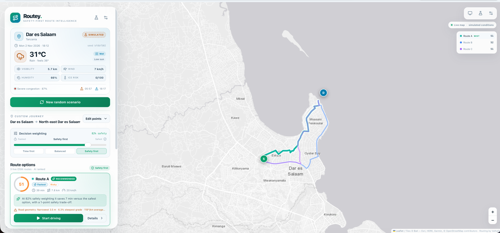
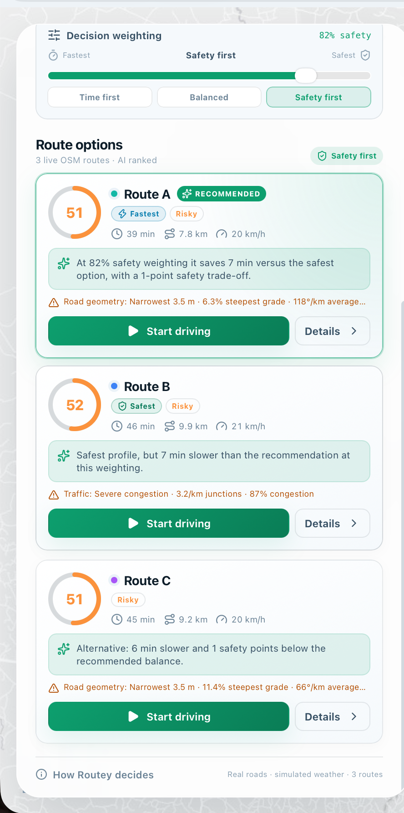
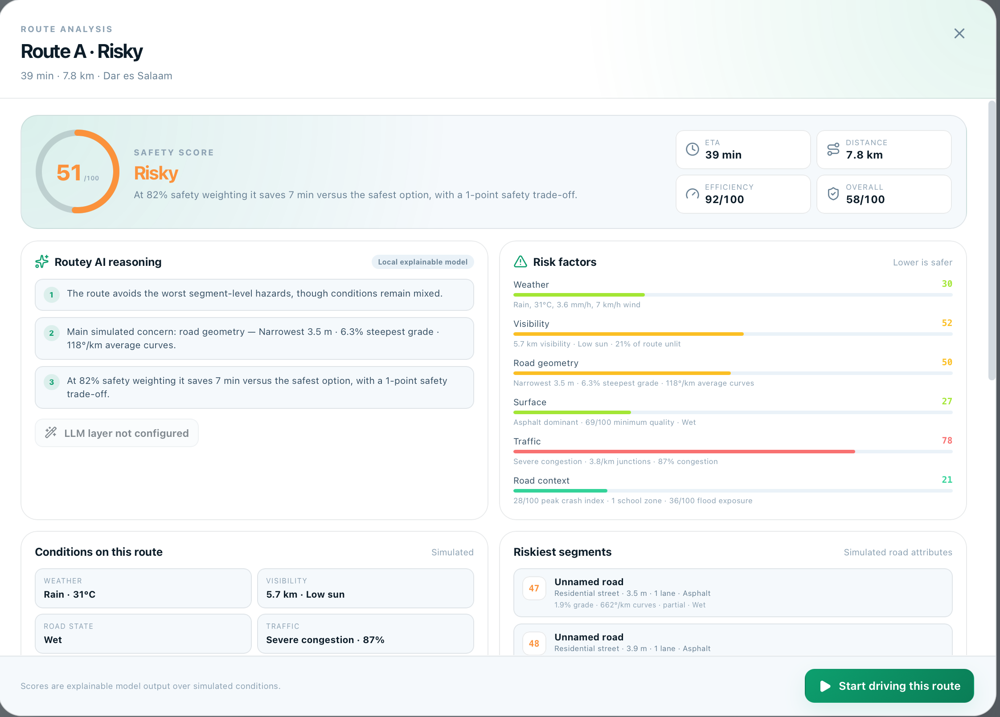
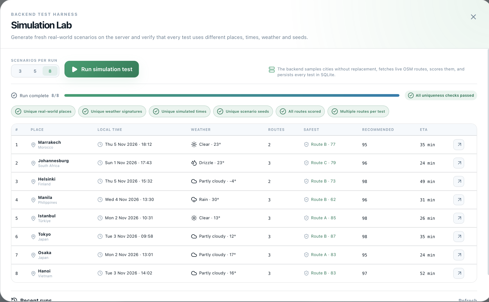

# Routey

**A Navigation Web App that considers more dimensions of safety.**

Routey explores real-world routes on a live OpenStreetMap, generates a simulated
set of weather, daylight, traffic, and road conditions, then recommends a route with an
explainable safety score and a reason under every situation.

> **Simulation demo — not for real safety decisions.** Weather, traffic, road width, surface,
> grade, crash history and other road attributes are generated. Map tiles, road geometry,
> turn maneuvers and base travel times come from live OpenStreetMap services. 
> Don't use Routey for real driving or safety decisions.

## How to Access
- **http://47.243.231.232** (Avaliable till dec 2026)

## What it does


- **Live map, real roads.** A real-life map sourced from OpenStreetMap. Every scenario uses real road geometry, real turn
  maneuvers and real distances.
- **Random world simulator.** The backend picks a real city from a curated global
  catalogue, samples two points within its road network, fetches live routes, and generates
  a seed-specific time, weather, daylight phase, traffic profile, and road-condition story.
- **Safety score.** A transparent local risk engine scores every segment from six factor
  groups, compounds dangerous combinations (ice + steep bend, fog + unlit road, etc.), and
  applies a worst-segment penalty.


- **Route recommendations.** Compare two or three live routes. Each card shows its safety
  score, safety label, ETA, distance, average speed, recommendation/trade-off reason, and
  its top simulated hazard.
- **Adjustable decision weighting.** Slide between *Fastest* and *Safest*. The backend
  re-ranks the routes and rewrites the recommendation reasons at the chosen weighting.


- **AI reasoning.** The local explainable engine decides every score and generates reasons
  under every path. An optional OpenAI-compatible LLM can rewrite/enrich explanations; it
  is explicitly instructed never to change scores or invent conditions.


- **Simulation Lab.** A backend test harness runs 3–8 fresh scenarios, verifies that places,
  weather signatures, times and seeds are all unique, and stores every run in SQLite.


- **Auto / light / dark theme.** Auto follows the operating-system preference; manual
  overrides are stored locally. 


## Stack

| Layer | Technology |
| --- | --- |
| Frontend | React 19, Vite 8, TypeScript, Leaflet, lucide-react |
| Backend | Bun 1.3, Hono, Zod |
| Database | SQLite via `bun:sqlite` (WAL mode) |
| Map tiles | Esri Light/Dark Gray basemap + reference labels |
| Routing | Valhalla public OSM router (`valhalla1.openstreetmap.de`) |
| Geocoding | Nominatim (`nominatim.openstreetmap.org`) |
| Optional AI narrative | Any OpenAI-compatible chat-completions endpoint, e.g. OpenRouter |


## How the simulation works

1. **Pick a place.** A curated catalogue of 80+ real cities provides a centre point,
   bounding box, IANA timezone and climate class. Random scenarios avoid the last five
   cities used; the Lab samples cities without replacement.
2. **Pick two points.** Two coordinates are sampled in the city box, constrained to a
   plausible 2.2–12.5 km separation. The simulator retries if the live router cannot find a
   drivable path.
3. **Generate the story.** From the scenario seed:
   - local date/time, solar elevation, sunrise/sunset and daylight phase;
   - climate- and season-aware temperature, precipitation, fog, visibility, wind, humidity
     and ice risk;
   - traffic volume from local rush hour, weather pressure and seeded variation;
   - per-road-segment width, lanes, speed limit, grade, surface, quality, lighting,
     shoulders, junction density, crash-history index, school zones, flood and animal risk.
4. **Fetch real routes.** Valhalla returns up to two alternatives. If fewer than two exist,
   Routey requests a real detour through a seeded waypoint, so comparisons remain real
   roads rather than fabricated geometry.
5. **Score and explain.** The local risk engine computes segment risks, factors, route
   safety, efficiency, overall recommendation and per-route reasons.
6. **Persist.** The scenario, simulated data, route geometry, maneuvers, segments, factors,
   reasons, and map-provider cache entries are stored in SQLite.

The **Simulation Lab** runs this pipeline server-side and then verifies:

- unique real-world places,
- unique weather signatures,
- unique simulated times,
- unique scenario seeds,
- every route scored,
- more than one route per scenario where available.


## Safety model

Each segment gets six risk values (0–100). They are combined with these weights:

| Factor | Weight | Examples |
| --- | ---: | --- |
| Weather | 27% | rain/snow intensity, ice, wind, temperature extremes |
| Visibility & daylight | 16% | visibility, fog, solar phase, street lighting |
| Road geometry | 21% | width, lanes, grade, curvature, shoulders |
| Surface | 10% | asphalt/gravel/unpaved, surface quality, wet/icy state |
| Traffic | 13% | congestion, junction density, speed environment |
| Road context | 13% | crash-history index, school zones, flood/animal risk |

Compounding hazards add extra risk, for example:

- ice on a steep or curved segment,
- heavy precipitation on a narrow road,
- low visibility on an unlit segment,
- high wind on a high-speed road,
- snow on a steep grade.

The route risk is the distance-weighted average plus a **12% worst-segment penalty**, so a
single very bad segment cannot be hidden by otherwise easy roads. Safety is
`100 − route risk`, clamped to 1–99.

Efficiency compares simulated ETA, distance and traffic exposure with the fastest option.
The overall recommendation is:

```text
overall = safetyWeight × safety + (1 − safetyWeight) × efficiency
```

The default is **80% safety / 20% efficiency**. The sidebar slider changes the weighting;
the backend re-ranks the routes and updates every recommendation reason.

## Database

SQLite tables created automatically:

| Table | Purpose |
| --- | --- |
| `cities` | Seeded global city catalogue with bbox, timezone and climate |
| `scenarios` | Seed, place, simulated time, weather, traffic, priority |
| `routes` | Geometry, maneuvers, road segments, scores, factors, reasons |
| `map_cache` | Cached Valhalla and Nominatim responses with TTL |
| `lab_runs` | Backend test runs, checks, progress and summaries |
| `lab_run_scenarios` | Links Lab runs to generated scenarios |

Route geometry and maneuvers are real map data; generated conditions and scores are stored
alongside them for auditability. Map raster tiles are not stored in SQLite.

## Known limitations

- Conditions and safety scores are **simulated**, not authoritative real-world data.
- Due to zoom limitations of OpenStreetMap, map could not be zoomed too large, or
it would show "data not yet avaliable" 
- Safety weights are a designed expert model, not validated crash statistics.
- The optional LLM explains decisions but does not decide the score.
- The app is a demo; it has no user accounts, authentication, or production monitoring.

## Credits

Basemap tiles © Esri. Map/routing data © OpenStreetMap contributors. Routing by Valhalla.
Place search by Nominatim. Built with Bun, Hono, React, Vite and Leaflet.
